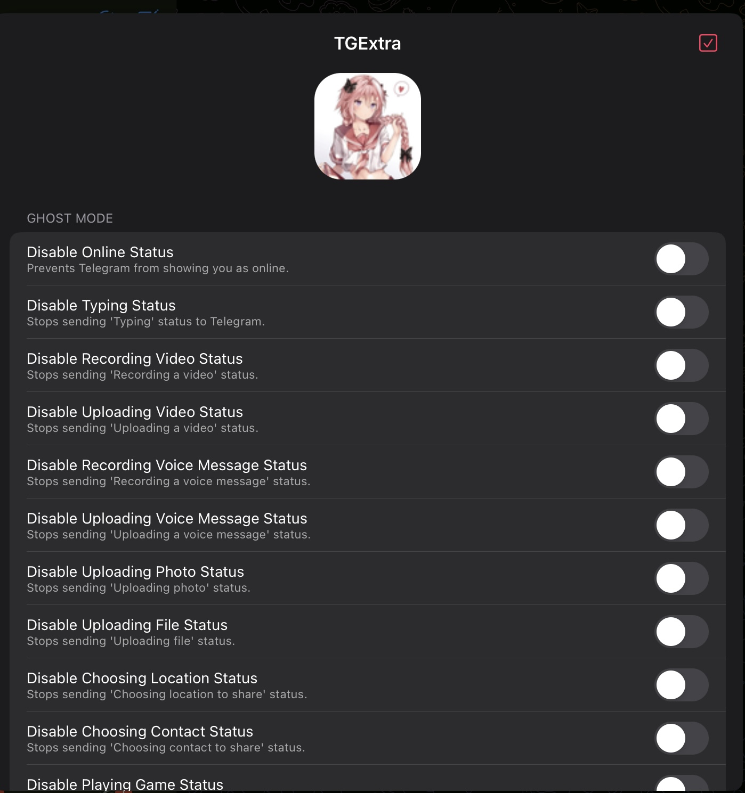
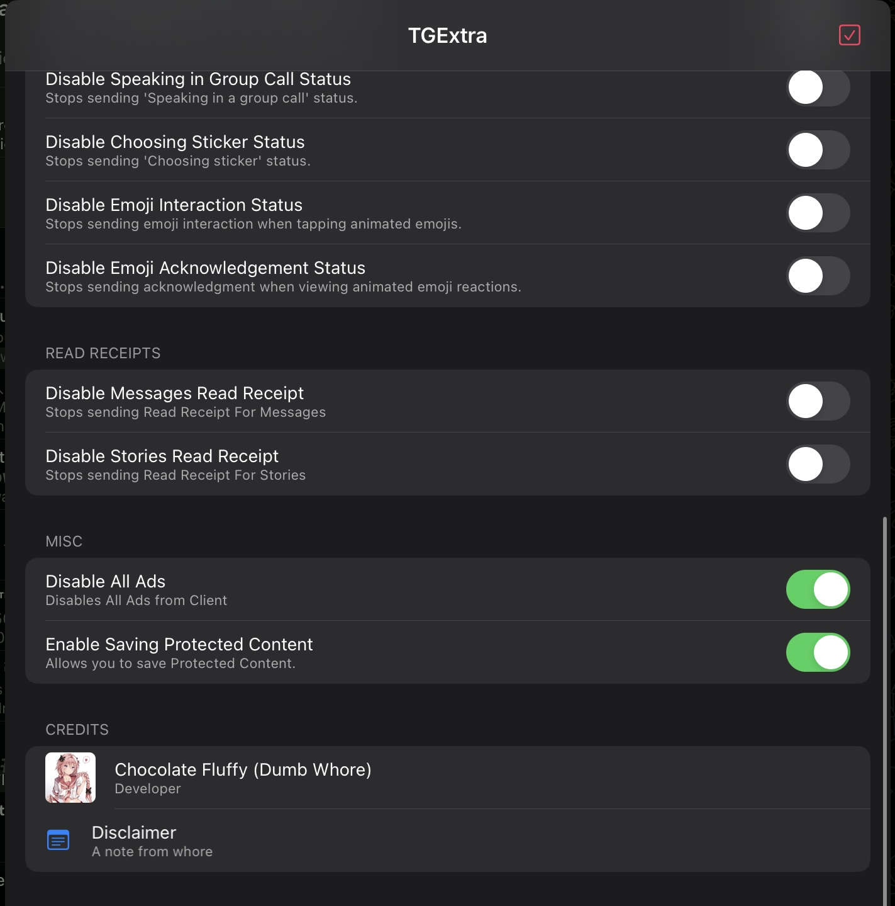

# TGExtra
A simple Telegram iOS Tweak.

Open the tweak menu by long-pressing **Ask a Question** in Telegram Settings,
long-pressing the screen with three fingers, or tapping the Chats tab five times.

## Screenshots

## Features

- Disable Ads
- Ghost Mode
- No Read Receipt for messages and Stories
- Ghost exceptions: manage users from their profile or the tweak menu. Exceptions
  apply to typing and read receipts; online status remains hidden globally.
- Save and forward protected content
- Normalize high-frame-rate videos (including 60 fps video messages and 120 fps
  stories) to H.264/AAC at 30 fps before saving to Photos, preserving duration
  and audio. Works independently of the protected-content bypass.
  Ordinary 24/30 fps videos are unchanged.
  This does not undo slow motion already rendered into a previously saved file.
- Ignore copy protection in private chats, independently of the protected-content
  toggle. Reopen the other person's profile after changing this option to refresh
  cached chat settings. The server-side sharing setting remains unchanged.
- Keep deleted messages and messages with chat auto-delete timers
- Keep edit history, including rich text, formatting and attachment changes; tap the pencil beside a message to view revisions
- Disable screenshot notifications for supported Telegram requests
- View disappearing media without starting its timer, with an optional label
- Video to Voice: send the audio track as a voice message, respecting preview trims
- Fix the Files picker and clear its temporary cache
- Fake location and ten interface languages

The integration uses the Telegram API 13.0 sources already in this repository.
Private UI hooks depend on the host app exposing the corresponding methods.
New features default to off; existing preferences are preserved on upgrade.

Edit history keeps versions observed while Anti-Edit is enabled, including
outgoing messages and empty media captions. Compact send replies use the
original request text when its chat can be resolved. Rich-message text,
formatting entities and attachment metadata are retained; the history labels
formatting and media changes even when the caption stays the same. It does not
archive attachment file bytes or provide playback of replaced attachments.
Each edited message retains its first observed version and up to 19 recent
revisions. Loading other messages does not evict saved histories; only the cache
of unedited originals is limited to 2000 messages. Versions the tweak never
received cannot be recovered.

Histories and deletion/timer markers are isolated by the local account record,
chat, message ID and message namespace. Ordinary, scheduled, quick-reply and
ephemeral messages cannot share a history accidentally. Sending a scheduled
message still removes it from the scheduled queue normally. Responses with an
older `editDate` cannot append a stale version; the latest date is persisted even when the text stays the same. Different edits bearing
the same second-resolution date are retained in arrival order.
Account identity comes from the connection's account directory and the message
node's account context. If it cannot be resolved, history recording and lookup
are skipped. The same rule applies to marker recording and lookup. Older
histories and markers without an account key remain stored under their original
preferences keys, but are not automatically assigned or displayed: their owning
account cannot be determined reliably.

Anti-Revoke handles individual cloud deletions and channel history-range
removals. TTL protection also runs on edits, service messages, dialog lists and
history/difference responses whose trailing User or Chat constructors are newer
than the bundled schema. Timer classifications and deletion markers are kept
until the message database is cleared; unrelated traffic cannot evict them.

To protect cloud messages during channel history revalidation, TGExtra retains
the last 2000 observed, unrevoked cloud messages in arrival order and pins
snapshots once their deletion is observed. For messages.getMessages and
channels.getMessages, a missing requested message can be supplied from the
matching account/chat snapshot. Ordinary observations are saved after a short
delay; deletion pins are saved immediately. This cannot restore an unobserved
or evicted message, a failed validation RPC, or media no longer available from
the server/cache.

This remains an injected tweak with Objective-C networking/UI hooks. Secret
chat decryption, explicit local history clearing, local media expiry and other
Postbox operations performed without a network response are not intercepted.
Timers already stored before enabling protection are not retroactively removed.
There is no dependency on private Swift function hooks.

In the tweak menu, **Message Data → Clear Message Database** removes TGExtra's
edit histories, cached originals and snapshots, deletion/timer markers and
older history archives for all accounts after confirmation. Telegram chats and
tweak settings are preserved. Recording continues for subsequently received messages while the
corresponding features are enabled.

## Building and checks

Build with Theos and an iOS SDK using `make package`. The existing rootful,
rootless and roothide packaging schemes are retained.

After changing translations, run `python3 generate_langs.py` to regenerate the
embedded fallback translations.

Run `Tests/run.sh` on macOS to check protocol transformations, ghost exceptions,
settings migration, account/namespace isolation, formatting/media revisions,
TTL paths, validation recovery and persisted history. Tests use in-memory
preferences.
UI interaction, video extraction and installation still require an iOS device.
Run `Tests/story_video_export.sh` on macOS with FFmpeg installed to check story
video frame rate, duration, audio, rotation and export failure handling.
Set `THEOS` or `LOGOS_PL` to also test the Photos hooks and temporary-file
cleanup. Pass a video path to additionally verify export of a real sample.

## Acknowledgements

The additional functions and menu are adapted from the local **mxgram / Mx**
fork, with its networking code adapted to TGExtra's API 13.0 and branding.

## Disclaimer

This project is an **independent modification (tweak)** for the Telegram app. I am **not affiliated, associated, authorized, endorsed by, or in any way officially connected with Telegram Messenger LLP**, or any of its subsidiaries or affiliates.

This tweak is created solely for **personal and educational purposes**. Use it at your own risk.

**I do not take any responsibility for any issues, damages, or consequences** resulting from the use or misuse of this tweak. If something breaks, it's not my problem.
